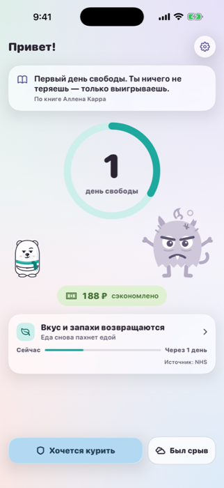
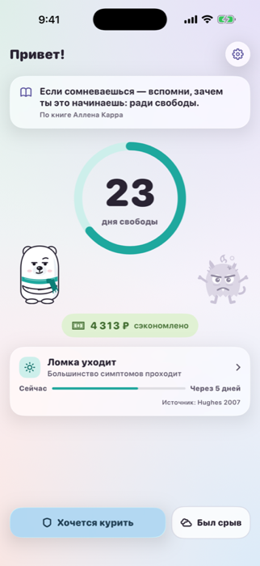
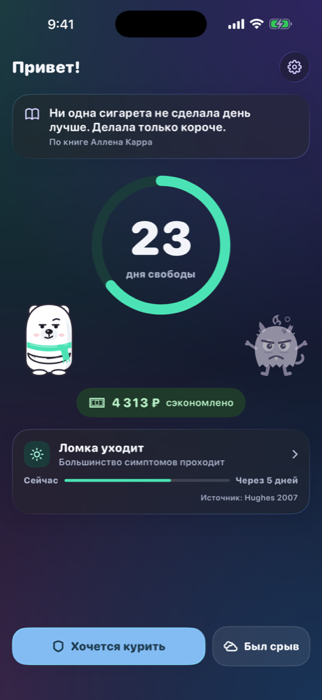

  

<h1 align="center">Норд — свобода от сигарет</h1>

  Приложение для iPhone, которое помогает бросить курить по идеям книги Аллена Карра «Лёгкий способ бросить курить». 
  Белый медведь Норд рядом каждый день, пока никотиновый монстр слабеет и исчезает.

  
  

  
  
  

## Что умеет

- **Дни и деньги** — сколько дней свободы и сколько денег осталось у тебя.
- **Никотиновый монстр** — в первые дни огромный, без дозы сдувается и к 12 неделям исчезает.
- **«Хочется курить»** — правда о никотине вместо дыхательных упражнений.
- **Путь организма** — что восстанавливается и когда, с источниками (ВОЗ, исследования).
- **Срыв без стыда** — честно отметить и увидеть, сколько пользы уже получено.
- **Темы и виджеты** — четыре пастельные палитры, светлая и тёмная тема, виджеты на рабочем столе и экране блокировки.

Бесплатно, без регистрации, данные хранятся только на iPhone.

## Как помочь проекту

| | |
|---|---|
| ✉️ **Написать** | В приложении: Настройки → «Написать нам» (без аккаунта: вопрос, идея, проблема или другое) |
| 💡 **Идея на GitHub** | [Предложить](https://github.com/She-Wolf/nord-app/issues/new?template=idea.yml), если есть аккаунт GitHub |
| 🐞 **Ошибка** | [Сообщить](https://github.com/She-Wolf/nord-app/issues/new?template=bug.yml) |
| 👍 **Голосовать** | Ставьте 👍 [идеям](https://github.com/She-Wolf/nord-app/issues?q=is%3Aissue+label%3Aидея+sort%3Areactions-%2B1-desc), которые нужны вам. Популярные делаем первыми |
| 🗺️ **Планы** | [Роадмап](ROADMAP.md) |
| ✈️ **Новости и опросы** | [Telegram-канал @nord_freedom](https://t.me/nord_freedom) |

## О репозитории

Здесь сайт, роадмап и обратная связь. Код приложения хранится отдельно, в закрытом репозитории.

- [Политика конфиденциальности](https://she-wolf.github.io/nord-app/privacy.html)
- [Поддержка](https://she-wolf.github.io/nord-app/support.html)

Приложение не ставит диагнозов и не заменяет врача.
